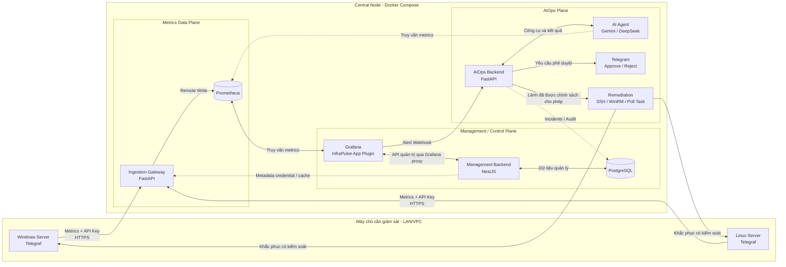
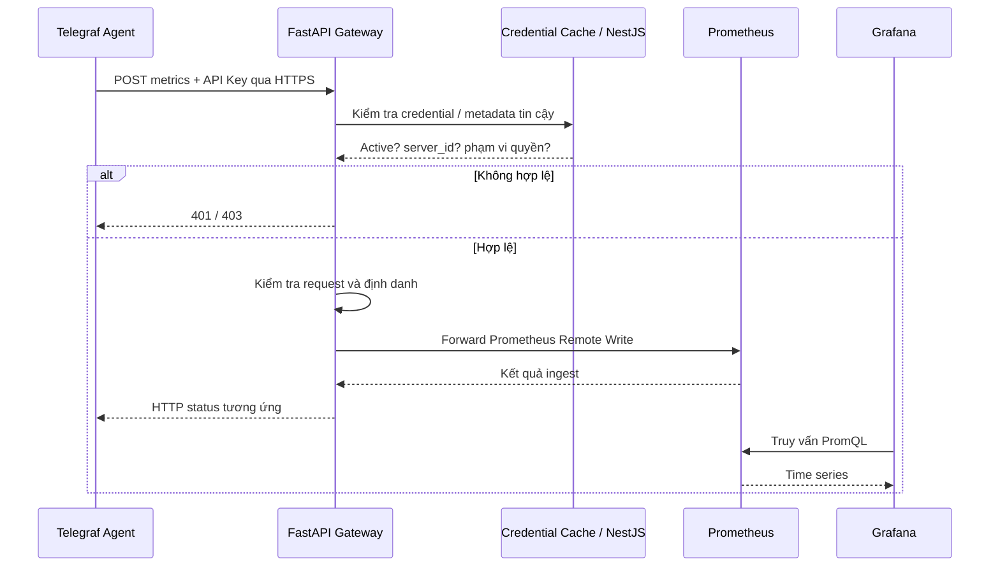
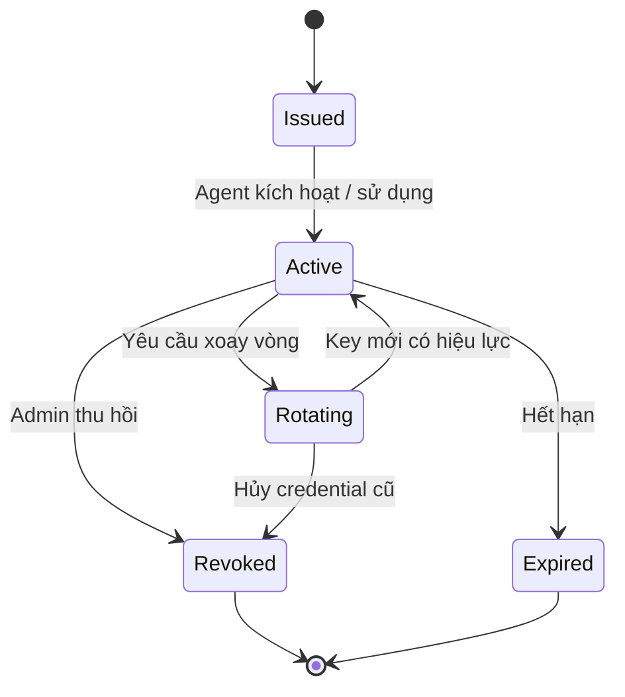
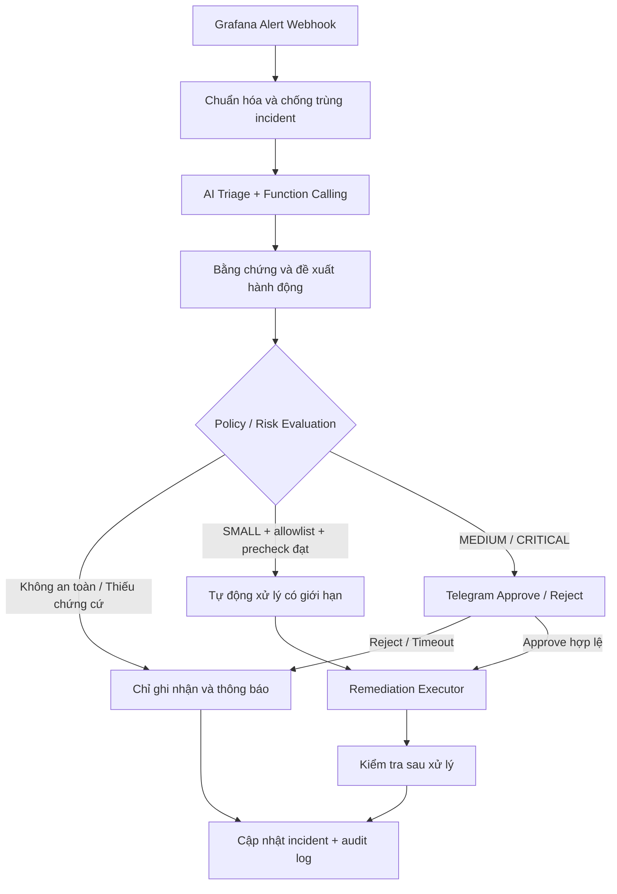

# InfraPulse

> **Nền tảng giám sát hạ tầng, quản lý máy chủ và tự động hóa ứng cứu sự cố tập trung (Centralized Infrastructure Monitoring & AIOps Platform).**
>
> **Infra** = *Infrastructure* (hạ tầng); **Pulse** = *nhịp đập* — thể hiện khả năng quan sát liên tục “sức khỏe” của hệ thống CNTT.

**Trạng thái tài liệu:** Đặc tả định hướng kiến trúc và phạm vi phát triển — **không phải tuyên bố các chức năng đã hoàn thành**.  
**Tên dự án chính thức:** **InfraPulse**.  
**Môi trường mục tiêu:** Hệ thống self-hosted trong mạng LAN hoặc VPC nội bộ.  
**Hình thức triển khai trung tâm:** Docker Compose trên một máy chủ quản lý.  
**Cập nhật tài liệu:** 30/10/2026.

---

## Mục lục

1. [Giới thiệu và bối cảnh](#1-giới-thiệu-và-bối-cảnh)
2. [Mục tiêu và giá trị cốt lõi](#2-mục-tiêu-và-giá-trị-cốt-lõi)
3. [Phạm vi triển khai](#3-phạm-vi-triển-khai)
4. [Nguyên tắc thiết kế](#4-nguyên-tắc-thiết-kế)
5. [Kiến trúc tổng thể](#5-kiến-trúc-tổng-thể)
6. [Các thành phần và công nghệ](#6-các-thành-phần-và-công-nghệ)
7. [Luồng vận hành chi tiết](#7-luồng-vận-hành-chi-tiết)
8. [Quản lý máy chủ, agent và API Key](#8-quản-lý-máy-chủ-agent-và-api-key)
9. [Thu thập và lưu trữ metrics](#9-thu-thập-và-lưu-trữ-metrics)
10. [Giám sát, dashboard và cảnh báo](#10-giám-sát-dashboard-và-cảnh-báo)
11. [AIOps, AI Agent và tự động xử lý sự cố](#11-aiops-ai-agent-và-tự-động-xử-lý-sự-cố)
12. [Mô hình dữ liệu](#12-mô-hình-dữ-liệu)
13. [Thiết kế API tham khảo](#13-thiết-kế-api-tham-khảo)
14. [Bảo mật và phân quyền](#14-bảo-mật-và-phân-quyền)
15. [Triển khai và cấu hình](#15-triển-khai-và-cấu-hình)
16. [Khả năng chịu lỗi, hiệu năng và mở rộng](#16-khả-năng-chịu-lỗi-hiệu-năng-và-mở-rộng)
17. [Lộ trình phát triển](#17-lộ-trình-phát-triển)
18. [Kiểm thử và tiêu chí nghiệm thu](#18-kiểm-thử-và-tiêu-chí-nghiệm-thu)
19. [Giới hạn, rủi ro và quyết định còn mở](#19-giới-hạn-rủi-ro-và-quyết-định-còn-mở)
20. [Cấu trúc mã nguồn đề xuất](#20-cấu-trúc-mã-nguồn-đề-xuất)
21. [Thuật ngữ](#21-thuật-ngữ)
22. [Tài liệu tham khảo](#22-tài-liệu-tham-khảo)

---

## 1. Giới thiệu và bối cảnh

### 1.1. InfraPulse là gì?

**InfraPulse** là nền tảng **giám sát và vận hành hạ tầng CNTT tập trung** dành cho nhiều máy chủ Windows và Linux trong cùng một mạng nội bộ. Hệ thống thu thập metrics và trạng thái dịch vụ, trực quan hóa bằng Grafana, quản lý agent và API Key, phân tích cảnh báo bằng AI Agent và hỗ trợ khắc phục sự cố theo chính sách an toàn.

Thay vì cài Prometheus, Grafana và toàn bộ bộ công cụ monitoring lên từng máy chủ, InfraPulse chỉ cài **Telegraf Agent** và những collector thực sự cần thiết trên các máy đích. Dữ liệu được **đẩy (push)** về **Ingestion Gateway** tại máy chủ trung tâm, sau đó được chuyển đến kho lưu metrics. Người vận hành tương tác chủ yếu qua **Grafana**, trong đó có **InfraPulse App Plugin** để thực hiện các thao tác quản trị.

InfraPulse có ba năng lực liên kết với nhau:

1. **Monitoring:** Theo dõi tài nguyên và dịch vụ đa máy chủ.
2. **Management:** Quản lý danh sách máy chủ, agent, credential, profile và trạng thái kết nối.
3. **AIOps:** Phân tích sự cố có ngữ cảnh, đề xuất xử lý, phê duyệt và thực thi tác vụ an toàn.

### 1.2. Bài toán cần giải quyết

Khi doanh nghiệp vận hành nhiều máy chủ, người quản trị thường phải đối mặt với các vấn đề:

- Dữ liệu phân tán, phải đăng nhập từng máy để kiểm tra CPU, RAM, ổ đĩa và dịch vụ.
- Khó biết một máy chủ hay agent đã ngừng gửi dữ liệu hay chưa.
- Cấu hình giám sát thiếu nhất quán giữa Windows, Linux, Docker và các dịch vụ đặc thù.
- Nhiều cảnh báo rời rạc gây **alert fatigue**; khó xác định sự cố chính và những hệ quả liên quan.
- Khắc phục thủ công qua SSH hoặc WinRM tốn thời gian, khó lưu lại lịch sử và dễ sai sót.
- Thiếu cơ chế cấp/thu hồi credential, theo dõi cấu hình và kiểm toán các hành động tự động hóa.

InfraPulse hướng đến việc kết hợp **quan sát, quản trị và ứng cứu sự cố** trong một kiến trúc thống nhất nhưng có thể phát triển theo từng giai đoạn.

### 1.3. Định hướng so với một hệ thống monitoring thông thường

Một hệ thống monitoring cơ bản thường đi theo luồng:

`Thu thập dữ liệu → Lưu metrics → Dashboard → Cảnh báo`

InfraPulse mở rộng thành:

`Đăng ký máy chủ → Cấp API Key → Thu thập metrics → Cảnh báo → AI điều tra → Đề xuất hành động → Phê duyệt khi cần → Khắc phục → Kiểm tra lại → Ghi lịch sử`

Điểm khác biệt không nằm ở việc thay thế Prometheus hay Grafana, mà ở **lớp quản lý và lớp tự động hóa vận hành** được xây dựng xung quanh các công cụ đó.

---

## 2. Mục tiêu và giá trị cốt lõi

### 2.1. Mục tiêu tổng quát

Xây dựng một nền tảng self-hosted có khả năng **giám sát nhiều máy chủ từ một điểm tập trung**, quản lý vòng đời agent và credential, phát hiện sự cố, trợ giúp phân tích nguyên nhân bằng AI và hỗ trợ quy trình xử lý sự cố **có kiểm soát của con người**.

### 2.2. Mục tiêu chức năng

| Nhóm | Mục tiêu |
|---|---|
| Giám sát hệ thống | Thu thập CPU, RAM, Disk, Network, uptime và trạng thái dịch vụ |
| Giám sát mở rộng | Theo dõi Docker, VM, SSL, backup, database và ứng dụng thông qua plugin/collector thích hợp |
| Quản trị tập trung | Quản lý server, agent, API Key, monitoring profiles và cấu hình |
| Ingestion an toàn | Nhận metrics qua HTTP(S), xác thực agent, ràng buộc định danh và kiểm soát dữ liệu đầu vào |
| Trực quan hóa | Hiển thị metrics, dashboard, alerting và thông tin máy chủ từ Grafana |
| AIOps | Nhận alert, tra cứu metrics/logs/runbooks, phân tích và đề xuất hướng xử lý |
| ChatOps | Gửi yêu cầu Approve/Reject qua Telegram cho hành động cần phê duyệt |
| Remediation | Chạy tác vụ được cho phép, kiểm tra kết quả và lưu audit log |
| Triển khai | Đóng gói các dịch vụ trung tâm và quản lý bằng Docker Compose |

### 2.3. Mục tiêu phi chức năng

- **An toàn:** Không gửi API Key qua kênh không được bảo vệ trong môi trường vận hành; nguyên tắc quyền tối thiểu và xác thực rõ ràng giữa các dịch vụ.
- **Dễ mở rộng:** Bổ sung server, loại metrics, profile, công cụ AI và backend lưu trữ mà không thiết kế lại toàn hệ thống.
- **Dễ bảo trì:** Tách các trách nhiệm chính theo dịch vụ, có log và health check cho từng thành phần.
- **Quan sát được:** Theo dõi độ trễ ingestion, tỷ lệ lỗi, tuổi dữ liệu, trạng thái agent và trạng thái tác vụ xử lý.
- **Tái lập được:** Có cấu hình, dữ liệu demo, kịch bản kiểm thử và hướng dẫn triển khai rõ ràng.
- **Kiểm soát AI:** Kết quả AI là **đề xuất có kiểm chứng**, không phải quyền thực thi lệnh tùy ý.

---

## 3. Phạm vi triển khai

### 3.1. Phạm vi ban đầu

- Một **máy chủ trung tâm (Central Node)** chạy các dịch vụ quản lý và monitoring.
- Từ **1–2 máy ảo Windows/Linux** cho thử nghiệm MVP, tăng dần khi luồng dữ liệu ổn định.
- Các máy kết nối trong **LAN hoặc VPC nội bộ**; không đặt Gateway công khai trên Internet.
- Giao diện vận hành tập trung ở **Grafana + InfraPulse App Plugin**.
- Cơ sở dữ liệu PostgreSQL cho nghiệp vụ quản lý và lịch sử sự cố.
- Prometheus self-hosted làm kho metrics giai đoạn đầu.

### 3.2. Các nhóm đối tượng theo dõi

| Đối tượng | Ví dụ chỉ số/trạng thái | Cách thu thập dự kiến |
|---|---|---|
| Windows Server | CPU, RAM, Disk, Network, Windows Services | Telegraf inputs / collector tương ứng |
| Linux Server | CPU, RAM, Disk, Network, load, uptime, systemd services | Telegraf inputs / script phù hợp |
| Docker | CPU, RAM, network, container up/down, restart | Telegraf Docker plugin / exporter |
| Máy ảo | Power state, tài nguyên, thông tin VM | API hypervisor / adapter riêng |
| SSL/TLS | Thời điểm hết hạn, số ngày còn lại, lỗi kiểm tra chứng chỉ | Probe / custom collector |
| Backup | Job thành công/thất bại, lần chạy gần nhất, độ trễ sao lưu | Script / adapter với hệ thống backup |
| Database / Web service | Kết nối, latency, tình trạng dịch vụ | Input plugin / exporter chuyên dụng |
| Logs | Sự kiện hệ thống, log ứng dụng, log lỗi | Pipeline logs riêng (ví dụ Alloy → Loki) |

### 3.3. Ngoài phạm vi MVP

Giai đoạn đầu **chưa yêu cầu** hỗ trợ Kubernetes quy mô lớn, multi-tenant phức tạp, kết nối qua Internet công cộng, high availability đầy đủ, tự động sửa mọi loại lỗi hoặc thay thế hệ thống SIEM/ITSM chuyên dụng.

Các chức năng **AI triage**, **remote configuration**, **one-command agent installation**, **Loki**, **VM/backup integration** và **nhiều storage backend** được phát triển theo thứ tự ưu tiên; không coi tất cả là bắt buộc để chứng minh MVP ingestion.

---

## 4. Nguyên tắc thiết kế

### 4.1. Tách trách nhiệm, không tách microservice một cách máy móc

InfraPulse đi theo mô hình **microservices ở mức hợp lý**: mỗi dịch vụ sở hữu một nghiệp vụ rõ ràng, có API và vòng đời triển khai riêng. Không cần tạo một microservice cho từng endpoint hoặc bảng dữ liệu.

Ba dịch vụ ứng dụng cốt lõi:

1. **Management Backend — NestJS:** Quản lý tài sản hạ tầng, agent, API Key, profile và quyền truy cập.
2. **Ingestion Gateway — FastAPI:** Nhận và kiểm soát metrics trước khi forward tới storage.
3. **AIOps Backend — FastAPI:** Nhận cảnh báo, điều phối AI triage, approval và remediation.

Các dịch vụ hạ tầng như **Prometheus, Grafana, PostgreSQL và Loki (khi bổ sung)** là các thành phần độc lập trong hệ thống, không có nghĩa tất cả đều do nhóm tự phát triển.

### 4.2. Ba mặt phẳng kiến trúc

- **Metrics Data Plane:** Dòng metrics từ agent tới Gateway, Prometheus và dashboard.
- **Management / Control Plane:** Vòng đời máy chủ, API Key, profile, định danh và cấu hình.
- **AIOps Plane:** Cảnh báo, tra cứu, phân tích, phê duyệt và thực thi tác vụ.

Việc tách ba plane giúp tránh đưa logic quản trị hoặc AI vào đường nhận metrics có tần suất cao.

### 4.3. Một giao diện Grafana, không xây Admin Web riêng

**Không triển khai Admin Web React/Next.js độc lập.** Thay vào đó, InfraPulse phát triển **Grafana App Plugin** bằng React/TypeScript. Plugin cung cấp các trang quản trị trong giao diện Grafana, sử dụng cơ chế đăng nhập, điều hướng và trải nghiệm dashboard sẵn có của Grafana.

> **Phân biệt quan trọng:** App Plugin là **giao diện**, còn **Management Backend NestJS vẫn tồn tại** và thực hiện kiểm tra quyền, logic nghiệp vụ và lưu trữ. Việc chỉ hiển thị hoặc ẩn nút trong plugin không đủ để bảo vệ các API quản trị.

### 4.4. Không dùng Nginx trong kiến trúc MVP

Vì các server và Central Node nằm trong LAN/VPC, MVP cho Telegraf kết nối **trực tiếp tới FastAPI Ingestion Gateway**. Không có Nginx hoặc reverse proxy bắt buộc trong đường ingest.

Điều này **không có nghĩa có thể bỏ xác thực hoặc mã hóa**. Gateway vẫn cần API Key, chính sách mạng và **HTTPS/TLS** khi vận hành thực tế; có thể cấu hình TLS trực tiếp trên ASGI server trong lab hoặc bổ sung thành phần termination phù hợp ở giai đoạn sau.

---

## 5. Kiến trúc tổng thể

### 5.1. Sơ đồ kiến trúc logic



> Mermaid mô tả **kiến trúc mục tiêu**. Không phải toàn bộ mũi tên đã được triển khai. Đường logs/runbook được trình bày riêng ở mục AIOps để không làm rối sơ đồ tổng thể.

### 5.2. Phân luồng dữ liệu

| Luồng | Hướng đi | Mục đích |
|---|---|---|
| Metrics | Telegraf → FastAPI Gateway → Prometheus | Nạp số liệu thời gian thực |
| Monitoring | Grafana ↔ Prometheus | Dashboard, truy vấn và đánh giá alert |
| Management | Grafana App Plugin ↔ NestJS ↔ PostgreSQL | Quản lý server, agent, credential, profile |
| Xác thực agent | NestJS → Gateway cache / dữ liệu xác thực | Đồng bộ key, trạng thái và định danh |
| Alert | Grafana → AIOps Backend | Tạo, cập nhật hoặc đóng sự cố |
| AI tools | AIOps / AI Agent → Prometheus, logs, runbooks | Thu thập bằng chứng phân tích |
| Approval | AIOps Backend ↔ Telegram Bot | Yêu cầu và nhận quyết định của admin |
| Remediation | Backend → executor → target | Chạy tác vụ được phép |
| Audit | Management / AIOps → PostgreSQL | Lưu lịch sử và kết quả vận hành |

### 5.3. Phân biệt các loại dữ liệu

- **Metrics:** Dữ liệu số theo thời gian như CPU usage, RAM used, disk free → **Prometheus**.
- **Management data:** Thông tin máy chủ, API Key metadata, cấu hình, quyền và profile → **PostgreSQL**.
- **Incident data:** Trạng thái sự cố, quyết định, approvals, execution và audit → **PostgreSQL**.
- **Logs:** Bản ghi sự kiện, stack trace, Windows Event Logs, Linux Syslog → **Loki hoặc log backend riêng** khi triển khai.
- **Runbooks:** Hướng dẫn xử lý sự cố được kiểm duyệt → ban đầu dùng tệp có phiên bản; tương lai có thể tích hợp cơ sở tri thức/RAG.

**Không dùng Prometheus để lưu raw logs hoặc thông tin quản lý API Key.**

---

## 6. Các thành phần và công nghệ

### 6.1. Tổng quan stack

| Thành phần | Công nghệ đề xuất | Trách nhiệm chính | Giai đoạn |
|---|---|---|---|
| Agent | Telegraf | Thu thập và push metrics trên Windows/Linux | MVP |
| Metrics Gateway | Python, FastAPI, Uvicorn, HTTPX | Nhận HTTP(S), xác thực, kiểm tra, forward | MVP |
| Metrics Storage | Prometheus self-hosted | Lưu trữ và truy vấn time-series metrics | MVP |
| Dashboard/Alerting | Grafana | Dashboard, alert rules và webhook | MVP |
| Giao diện quản trị | Grafana App Plugin (React/TypeScript) | Servers, Agents, API Keys, Profiles, Heartbeats, Incidents | Giai đoạn quản lý |
| Management Backend | NestJS (Node.js/TypeScript) | API quản trị, vòng đời agent và credential | Giai đoạn quản lý |
| CSDL nghiệp vụ | PostgreSQL | Tài sản, credentials metadata, config, incidents, audit | Giai đoạn quản lý |
| AI Orchestrator | FastAPI | Điều phối alert, tools, chính sách xử lý | Giai đoạn AIOps |
| LLM | Gemini hoặc DeepSeek API | Phân tích ngữ cảnh và tạo đề xuất xử lý | Giai đoạn AIOps |
| ChatOps | Telegram Bot API | Thông báo và phê duyệt tác vụ | Giai đoạn AIOps |
| Remediation | SSH, WinRM hoặc Poll Task | Thực thi các hành động đã được cho phép | Giai đoạn AIOps |
| Log pipeline (tùy chọn) | Grafana Alloy / Fluent Bit → Loki | Thu thập, lưu trữ và truy vấn logs | Mở rộng |
| Triển khai | Docker, Docker Compose | Vận hành Central Node | MVP |

### 6.2. Telegraf Agent

Telegraf chạy trên từng máy đích, định kỳ lấy metrics thông qua các input plugin. Agent có thể thu thập dữ liệu cơ bản mà không cần hệ thống Prometheus/Grafana riêng tại máy đó.

**Nhiệm vụ:**

- Thu thập CPU, RAM, Disk, Network và uptime.
- Kết hợp plugin để theo dõi Windows Services, systemd, Docker và các dịch vụ khác.
- Chuyển dữ liệu sang định dạng được thống nhất; trong hướng MVP, lựa chọn **Prometheus Remote Write**.
- Gửi batch dữ liệu đến URL của Gateway, đính kèm API Key.
- Mang các nhãn cấu hình cần thiết; Gateway vẫn là nơi xác nhận danh tính chính thức.

**Giới hạn:** Telegraf là agent thu thập metrics, **không tự động trở thành** hệ thống đăng ký máy, tải profile động hay agent thực thi task từ xa. Các chức năng đó cần provisioning script, companion service hoặc thành phần bổ sung ở giai đoạn tiếp theo.

### 6.3. FastAPI Ingestion Gateway

Gateway là **biên tin cậy** của Metrics Data Plane. Đây không phải dashboard và không phải hệ thống quản lý server.

**Trách nhiệm:**

1. Tiếp nhận request từ các Telegraf agent qua HTTP(S).
2. Xác thực API Key và trạng thái credential.
3. Ánh xạ credential hợp lệ tới `server_id` / `agent_id` do hệ thống quản lý cấp.
4. Kiểm tra method, path, content type, giới hạn kích thước và tốc độ request.
5. Kiểm soát tính hợp lệ của nhãn định danh và dữ liệu đầu vào.
6. Forward payload theo giao thức phù hợp đến Prometheus hoặc storage adapter.
7. Trả về status code hợp lý, ghi log vận hành **không lộ secret**.

**Nguyên tắc thiết kế:** Gateway xử lý nhanh, ưu tiên I/O và không gọi LLM trên đường ingest. Tránh decode/re-encode toàn bộ metrics nếu yêu cầu bảo mật và chuẩn hóa nhãn không bắt buộc; tuy nhiên **không được tuyên bố đã xác thực hoặc sửa được nhãn `server_id` nếu chỉ chuyển nguyên payload**.

### 6.4. Management Backend (NestJS)

Đây là **backend quản lý máy chủ**, **không phải AIOps Backend**.

Các nhóm module dự kiến:

| Module | Vai trò |
|---|---|
| `AuthModule` / `AccessModule` | Quản lý quyền admin, role, phiên hoặc xác thực tích hợp Grafana |
| `ServerModule` | Danh mục máy chủ, hệ điều hành, environment, nhóm, trạng thái |
| `AgentModule` | Đăng ký agent, liên kết server, version và last seen |
| `ApiKeyModule` | Cấp, thay mới, thu hồi API Key và audit |
| `ProfileModule` | Mẫu cấu hình Windows Base, Linux Base, Docker, dịch vụ |
| `ConfigModule` | Phiên bản cấu hình, phân phối và rollback |
| `HeartbeatModule` | Trạng thái hoạt động và độ tươi dữ liệu |
| `IntegrationModule` | Đồng bộ dữ liệu xác thực cho Gateway, tích hợp khác |

**Mọi hành động nhạy cảm** (tạo key, thu hồi key, điều chỉnh profile, sửa quyền) được backend kiểm tra authorization và lưu audit độc lập với giao diện Grafana.

### 6.5. Grafana và InfraPulse App Plugin

Grafana giữ hai vai trò:

- **Monitoring:** kết nối Prometheus, tạo dashboard, truy vấn metrics, đánh giá alert rules và gửi webhook.
- **Cổng thao tác quản trị:** cài đặt **InfraPulse App Plugin** để mở các trang quản lý ngay trong Grafana.

Các trang dự kiến:

| Trang | Nội dung |
|---|---|
| **Overview** | Tổng số server, trạng thái hoạt động, cảnh báo quan trọng |
| **Servers** | Danh sách, chi tiết, nhóm máy chủ, trạng thái |
| **Agents** | Version, tình trạng kết nối, last seen, onboarding |
| **API Keys** | Cấp mới, thu hồi, xoay vòng, ngày tạo và trạng thái |
| **Monitoring Profiles** | Tạo, gán, cập nhật và kiểm soát cấu hình |
| **Heartbeats** | Độ tươi của metrics, kiểm tra agent offline |
| **AIOps Incidents** | Danh sách sự cố, nguyên nhân dự đoán, phương án và lịch sử xử lý |

**Giao tiếp plugin → Management Backend:** Ưu tiên cấu hình **Grafana data source proxy** hoặc **backend component của Grafana App Plugin** để gọi NestJS từ phía server một cách an toàn. Đây là hai hướng kỹ thuật có thể chọn, **không phải một cơ chế proxy tự xuất hiện** khi tạo plugin. Nếu dùng backend component, Grafana plugin backend thường được viết bằng **Go**; backend này chỉ làm adapter của plugin và **không thay thế NestJS**. Tránh nhúng secret đặc quyền trong React bundle hoặc browser.

**Phân quyền:** Grafana role hỗ trợ điều hướng/UI; API NestJS vẫn phải thực hiện kiểm tra quyền riêng, dựa trên danh tính được backend tin cậy và xác minh. Plugin chạy nội bộ cần xét đến yêu cầu **ký plugin** khi triển khai chính thức.

### 6.6. Prometheus

Prometheus lưu dữ liệu chuỗi thời gian, phục vụ PromQL và truy vấn từ Grafana hoặc AIOps Agent.

**Định hướng MVP:** Bật Prometheus **Remote Write Receiver** tại `/api/v1/write` (sử dụng cờ `--web.enable-remote-write-receiver`), cho Gateway forward các batch metrics hợp lệ.

**Lưu ý thiết kế:** Tài liệu Prometheus nêu receiver này **không phải phương án ingestion tối ưu để thay thế scraping ở quy mô lớn**. Vì vậy lựa chọn này phù hợp **thử nghiệm luồng push lưu lượng thấp**, không mặc định dùng cho hàng trăm/nghìn agent tải cao. Khi mở rộng có thể thay storage adapter hoặc backend, chẳng hạn Mimir, VictoriaMetrics hay AWS AMP, theo đánh giá thực tế.

### 6.7. AIOps Backend và AI Agent

**AIOps Backend (FastAPI)** nhận alert webhook, quản lý state machine của incident, khởi chạy AI triage, xác minh chính sách, gửi approval request và gọi executor.

**AI Agent** có thể tích hợp Gemini/DeepSeek để gọi các công cụ có phạm vi giới hạn như:

- `query_prometheus`: đọc metrics liên quan.
- `query_logs`: tra cứu log khi pipeline logs đã được triển khai.
- `search_runbook`: tìm hướng dẫn hoặc runbook phù hợp.
- `get_server_context`: lấy metadata đã được cấp phép từ Management Backend.

AI chỉ đưa ra **phân tích, mức độ tin cậy, bằng chứng, đề xuất có cấu trúc**. Một policy engine do backend kiểm soát mới quyết định hành động có được thực thi và có cần phê duyệt hay không.

### 6.8. Remediation Executor

Executor chạy tác vụ trên máy mục tiêu hoặc cung cấp task cho companion agent lấy về theo cơ chế polling.

- **SSH:** Phù hợp với một số tác vụ Linux.
- **WinRM:** Phù hợp với tác vụ Windows được cấu hình an toàn.
- **Poll Task:** Máy đích chủ động hỏi Central Node xem có task nào được cấp hay không; cần **task runner/companion agent**, không thể chỉ dựa vào Telegraf thuần.

Tất cả tác vụ phải có **allowlist, kiểm tra trước khi chạy, timeout, quyền tối thiểu, giới hạn phạm vi và log kiểm toán**.

---

## 7. Luồng vận hành chi tiết

### 7.1. Luồng A — Onboarding máy chủ

1. Admin truy cập Grafana → **InfraPulse App Plugin → Servers**.
2. Admin tạo bản ghi máy chủ với tên, hệ điều hành, nhóm, `environment` và các thông tin bắt buộc.
3. App Plugin gọi API của NestJS qua cơ chế proxy/adapter đã cấu hình.
4. NestJS tạo `server_id` cố định và bản ghi agent ở trạng thái **Pending**.
5. Backend cấp credential hoặc **enrollment token một lần** nếu sử dụng quy trình đăng ký tự động.
6. Admin cài Telegraf và cấu hình endpoint + credential trên máy đích.
7. Telegraf gửi batch metrics đầu tiên; Gateway xác thực và ánh xạ tới server.
8. Dữ liệu xuất hiện trong Prometheus; Management Backend cập nhật trạng thái dựa trên heartbeat/last-seen đáng tin cậy.
9. Grafana hiển thị server trong danh sách và dashboard.

**Giai đoạn đầu:** Cài agent và cấp cấu hình thủ công có hướng dẫn. **Giai đoạn sau:** Hỗ trợ lệnh cài đặt sinh tự động, tự đăng ký và cấp profile.

### 7.2. Luồng B — Thu thập metrics



**Lưu ý:** Sơ đồ trên biểu diễn thao tác logic. Trong triển khai thực tế, Gateway có thể kiểm tra từ **cache đồng bộ nội bộ** thay vì gọi NestJS cho mọi request. Phải thiết kế độ trễ áp dụng việc **revoke key** tương ứng với TTL cache.

### 7.3. Luồng C — Cảnh báo và xử lý sự cố

1. Grafana đánh giá alert rule từ metrics trong Prometheus.
2. Grafana gửi alert webhook tới AIOps Backend.
3. Backend chuẩn hóa alert, xác định `fingerprint` và tạo/cập nhật incident; tránh tạo trùng khi webhook được retry.
4. AI Agent sử dụng các tools để lấy metrics, logs (nếu có), runbook và metadata liên quan.
5. Backend lưu báo cáo phân tích, bằng chứng, đề xuất và mức độ rủi ro.
6. Policy Engine xác định **không hành động**, **xử lý tự động có giới hạn** hay **chờ duyệt**.
7. Với tác vụ cần phê duyệt, Telegram Bot gửi thông tin và nút **Approve/Reject**.
8. Nếu được duyệt, executor kiểm tra lại điều kiện và chạy **một action đã cho phép**, không chạy câu lệnh tùy ý do LLM tạo.
9. Backend lưu stdout/stderr đã lọc thông tin nhạy cảm, trạng thái thực thi, chi phí AI và audit.
10. Hệ thống kiểm tra metrics/trạng thái sau hành động để xác nhận kết quả và đóng hoặc chuyển tiếp incident.

### 7.4. Luồng D — Thu hồi API Key

1. Admin nhấn **Revoke** trong trang API Keys.
2. NestJS chuyển credential sang trạng thái `revoked`, lưu thời điểm và người thao tác.
3. NestJS phát tín hiệu thay đổi hoặc cập nhật dữ liệu xác thực để Gateway làm mới cache.
4. Các request mới bằng credential đó bị từ chối khi trạng thái thu hồi được áp dụng.
5. Ghi audit; cung cấp cơ chế cấp key thay thế theo quy trình rotate nếu cần.

---

## 8. Quản lý máy chủ, agent và API Key

### 8.1. Phân biệt Server, Agent và Credential

- **Server:** Thực thể máy chủ cần giám sát, có `server_id` do hệ thống quản lý cấp.
- **Agent:** Phiên cài đặt collector trên một server, có `agent_id`, version và trạng thái.
- **Credential/API Key:** Bí mật chứng minh quyền gửi metrics thay mặt cho một agent/server.

Không nên đồng nhất `server_id` (một định danh công khai) với **API Key** (một secret). Một máy có thể cần rotate key nhiều lần mà vẫn giữ nguyên `server_id`.

### 8.2. Vòng đời API Key



**Khuyến nghị triển khai:**

- Key được tạo bằng bộ sinh ngẫu nhiên mật mã, đủ entropy.
- Hiển thị phần secret **một lần khi tạo**; chỉ lưu **bản băm an toàn / verifier** trong DB.
- Có thể thiết kế key dạng `public_key_id.secret` để tra cứu bản ghi theo ID rồi xác minh secret bằng phép so sánh an toàn; tuyệt đối không dùng ID thay secret.
- Gắn key với `agent_id`, `server_id`, quyền ingest và trạng thái.
- Cho phép expire, revoke, rotate và ghi audit.
- Không đưa key vào URL, metrics labels, logs, dashboard, stack trace hay repository.
- Nếu quản lý `agent_id` và nhiều key trên một server, cần quy định key nào được phép đẩy dữ liệu từ nguồn nào.

### 8.3. Ràng buộc `server_id` và các nhãn

Client **không phải nguồn tin cậy** cho trường `server_id` trong payload. Gateway phải suy ra server thực tế từ credential hợp lệ. Với định dạng Prometheus Remote Write, nếu cần **thay thế/ép nhãn** bên trong payload thì phải **giải mã protobuf/snappy, kiểm tra hoặc chỉnh sửa time series, rồi mã hóa lại**, hoặc sử dụng một ingestion processor đáng tin cậy có khả năng tương đương.

Không thể khẳng định đã “chuẩn hóa nhãn” chỉ bằng cách thêm một HTTP header và chuyển nguyên body tới Prometheus. Đây là quyết định cần **kiểm thử cụ thể trong MVP** vì ảnh hưởng đến hiệu năng và tính toàn vẹn danh tính.

Ví dụ nhãn được phép sử dụng:

```text
server_id="srv-001"
environment="lab"
os="linux"
role="web"
```

Nên hạn chế nhãn có tính biến động cao như request ID, timestamp ngẫu nhiên hoặc chuỗi không giới hạn vì gây **cardinality explosion** trong Prometheus.

### 8.4. Monitoring Profiles

| Profile | Thành phần thu thập |
|---|---|
| `windows-base` | CPU, Memory, Disk, Network, Windows Services |
| `linux-base` | CPU, Memory, Disk, Network, uptime, systemd |
| `docker` | Tài nguyên, trạng thái và restart của container |
| `ssl-check` | Trạng thái và thời hạn chứng chỉ SSL/TLS |
| `backup-check` | Kết quả backup job và thời điểm backup gần nhất |
| `database-service` | Metrics tùy loại database |
| `custom-integration` | Plugin hoặc collector đặc thù |

Mỗi server có thể gán nhiều profile. Khi phát triển remote configuration, backend cần:

- Lưu bản cấu hình chuẩn và `version`.
- Tạo bản phát hành cấu hình theo server hoặc group.
- Cho agent/companion kiểm tra, tải và xác nhận áp dụng.
- Ghi `desired_version`, `applied_version`, thời điểm cập nhật và lỗi.
- Kiểm tra cấu hình trước khi áp dụng và cho phép rollback.

### 8.5. Heartbeat và trạng thái online/offline

Có thể bắt đầu bằng **freshness của metrics** thay vì bổ sung một kênh heartbeat riêng ngay lập tức:

- `last_metric_seen_at`: thời điểm Gateway/ingestion xác nhận đã nhận dữ liệu hợp lệ.
- `agent_heartbeat_at`: thời điểm heartbeat chuyên dụng, **chỉ có khi xây thêm cơ chế heartbeat**.
- `server_status`: Online / Stale / Offline / Unknown theo policy.

**Online** cần được định nghĩa bằng thời gian dữ liệu đến, không chỉ dựa vào việc có bản ghi trong DB. Ví dụ với chu kỳ gửi 30 giây, ngưỡng stale/offline có thể chọn theo số chu kỳ bị lỡ; đây là **cấu hình đề xuất**, không phải ngưỡng cố định cho mọi môi trường.

---

## 9. Thu thập và lưu trữ metrics

### 9.1. Giao thức ingestion dự kiến

Telegraf hỗ trợ serializer `prometheusremotewrite` đi cùng `outputs.http`. Dữ liệu được đóng gói dưới dạng **Prometheus Remote Write protobuf** và thường sử dụng nén Snappy. Các header giao thức cần được truyền đầy đủ.

**Ví dụ cấu hình Telegraf mang tính minh họa** (điều chỉnh theo phiên bản và plugin thực tế):

```toml
[agent]
  interval = "30s"
  flush_interval = "30s"

[[inputs.cpu]]
  percpu = true
  totalcpu = true

[[inputs.mem]]

[[inputs.disk]]
  ignore_fs = ["tmpfs", "devtmpfs"]

[[inputs.net]]

[[inputs.system]]

[[outputs.http]]
  url = "https://infrapulse.internal:8000/api/v1/ingest/remote-write"
  method = "POST"
  timeout = "10s"
  data_format = "prometheusremotewrite"
  # Ví dụ CA nội bộ khi sử dụng chứng chỉ tự cấp:
  # tls_ca = "/etc/telegraf/certs/lan-ca.pem"

  [outputs.http.headers]
    Content-Type = "application/x-protobuf"
    Content-Encoding = "snappy"
    X-Prometheus-Remote-Write-Version = "0.1.0"
    Authorization = "Bearer ${INFRAPULSE_AGENT_API_KEY}"
```

> **Không commit giá trị thật của `INFRAPULSE_AGENT_API_KEY`.** Cách nạp biến môi trường phụ thuộc vào Telegraf service trên Windows/Linux; cần hướng dẫn riêng cho từng hệ điều hành.

### 9.2. Endpoint Gateway và phản hồi

Endpoint đề xuất:

```http
POST /api/v1/ingest/remote-write
Authorization: Bearer <AGENT_API_KEY>
Content-Type: application/x-protobuf
Content-Encoding: snappy
X-Prometheus-Remote-Write-Version: 0.1.0
```

Body là **binary remote-write payload**, không phải JSON.

| Kết quả | HTTP status dự kiến | Ý nghĩa |
|---|---|---|
| Ingest thành công | 2xx | Upstream đã chấp nhận dữ liệu |
| Thiếu/sai credential | 401 | Chưa xác thực được |
| Credential hợp lệ nhưng không có quyền hoặc đã bị khóa | 403 | Không được phép ingest |
| Body/header/giao thức không hợp lệ | 400 / 415 | Request không phù hợp |
| Vượt giới hạn lưu lượng | 429 | Cần giảm tốc độ và retry có kiểm soát |
| Prometheus không khả dụng | 502 / 503 | Forward thất bại, không được báo thành công giả |

Mã phản hồi cuối cùng cần thống nhất với **ngữ nghĩa retry của Telegraf** và hành vi backend. Không nên gửi `2xx` khi dữ liệu chưa được lưu bền vững hoặc chưa được upstream xác nhận, trừ khi Gateway đã triển khai buffer/queue bền vững có hợp đồng riêng.

### 9.3. Forward đến Prometheus

- Destination mặc định: `http://prometheus:9090/api/v1/write` trong mạng nội bộ Docker.
- Prometheus bật remote write receiver ở giai đoạn thử nghiệm.
- Gateway chuyển các header giao thức cần thiết và body hợp lệ.
- Thiết lập timeout, maximum request size, retry có giới hạn và không retry mù quáng gây trùng/lũ request.
- Xác định rõ cách xử lý dữ liệu trễ, batch trùng, timestamp không hợp lệ và cardinality bất thường.

### 9.4. Storage adapter

Để tránh phụ thuộc vĩnh viễn vào một backend, Gateway có thể định nghĩa interface logic như:

```text
MetricsStorageAdapter
  ├── PrometheusRemoteWriteAdapter      (MVP)
  ├── GrafanaMimirAdapter                (tương lai)
  ├── VictoriaMetricsAdapter             (tương lai)
  └── AWSManagedPrometheusAdapter        (tương lai)
```

Adapter AWS AMP có thể cần ký request **AWS Signature Version 4** và cấu hình IAM riêng. Đây là **khả năng mở rộng dự kiến**, chưa thuộc phạm vi MVP.

### 9.5. Phân biệt metrics và logs

Pipeline logs chạy riêng, ví dụ:

`Windows Event Logs / Linux Syslog / Docker Logs → Grafana Alloy hoặc Fluent Bit → Loki`

AIOps Agent có thể truy vấn Loki khi triển khai. Một Gateway nhận metrics không tự động hỗ trợ logs chỉ vì cùng dùng HTTP; mỗi loại dữ liệu có giao thức, schema, auth và storage khác nhau.

---

## 10. Giám sát, dashboard và cảnh báo

### 10.1. Dashboard chính

**Infrastructure Overview** hiển thị:

- Tổng số server / online / stale / offline.
- Danh sách máy chủ đang có cảnh báo.
- CPU, RAM, Disk, Network usage theo máy chủ và theo nhóm.
- Dịch vụ, Docker containers, SSL và backup jobs có vấn đề (khi tích hợp).
- Biểu đồ theo thời gian; bộ lọc `server_id`, `environment`, `role`, `os`.

**Server Detail** hiển thị:

- Tên server, OS, IP nội bộ (theo quyền truy cập), thời điểm cập nhật cuối.
- CPU, Memory, Disk I/O, Disk usage, Network throughput.
- Các service/container được theo dõi.
- Alerts hiện hành và lịch sử incident liên quan.
- Cấu hình monitoring profile và agent version (lấy từ Management Backend).

### 10.2. Nguyên tắc thiết kế alert

Các alert rules cần có:

- **Tên và mô tả rõ ràng**.
- Ngưỡng hoặc điều kiện kích hoạt được kiểm thử.
- Thời gian `pending` / `for` để giảm nhiễu.
- Nhãn `server_id`, môi trường, severity và nhóm phụ trách.
- Runbook URL hoặc mã runbook nếu có.
- Cơ chế xử lý tình trạng **No Data**, **Error** và cảnh báo lặp.

Ví dụ quy tắc cần xây dựng và hiệu chỉnh sau kiểm thử:

| Rule | Điều kiện minh họa | Mức dự kiến |
|---|---|---|
| CPU High | CPU trên ngưỡng trong nhiều phút | Warning |
| Memory Critical | RAM khả dụng quá thấp | Critical |
| Disk Space Low | Ổ đĩa còn ít dung lượng | Warning/Critical |
| Service Down | Dịch vụ trọng yếu ngừng hoạt động | Critical |
| Metrics Stale | Không nhận mẫu mới quá thời gian cho phép | Warning |
| SSL Expiring | Chứng chỉ sắp hết hạn | Warning |
| Backup Failed | Job backup thất bại / quá hạn | Warning/Critical |

Ngưỡng trên là **mô tả mẫu**, không phải giá trị đã benchmark hoặc đã cấu hình sẵn.

### 10.3. Webhook đến AIOps

Grafana gửi notification hoặc alert payload tới AIOps Backend. Backend xác nhận nguồn webhook, chuẩn hóa trường và liên kết sự kiện với một incident. Trạng thái `firing` và `resolved` phải được xử lý khác nhau; không chạy remediation lặp lại khi nhận cùng một webhook.

---

## 11. AIOps, AI Agent và tự động xử lý sự cố

### 11.1. Mục tiêu AIOps

Từ một cảnh báo thô, InfraPulse tạo ra **đề xuất xử lý dựa trên bằng chứng** thay vì chỉ gửi thông báo “CPU cao” hay “dịch vụ down”. AIOps không thay quyền của người quản trị đối với hành động rủi ro.

### 11.2. Chu trình Closed-loop AIOps



### 11.3. Quy tắc mức độ xử lý

| Nhóm xử lý | Ví dụ | Quy tắc |
|---|---|---|
| **SMALL** | Làm sạch file tạm theo đường dẫn được cho phép, restart service thử nghiệm không trọng yếu | Chỉ tự động khi action đã có allowlist, precheck, giới hạn và rollback phù hợp |
| **MEDIUM** | Restart dịch vụ quan trọng, điều chỉnh cấu hình có ảnh hưởng | Chờ admin phê duyệt qua Telegram |
| **CRITICAL** | Tác vụ có thể gián đoạn dịch vụ/dữ liệu hoặc thay đổi lớn | Yêu cầu phê duyệt nghiêm ngặt; có thể mặc định không tự động thực thi |

**Phân loại SMALL/MEDIUM/CRITICAL là quyết định policy của hệ thống**, không được dựa duy nhất vào nhãn do LLM sinh ra. Bất kỳ hành động phá hủy, xóa dữ liệu, thay đổi firewall, quyền hệ thống hoặc bí mật đều cần chính sách riêng và ưu tiên thao tác thủ công.

### 11.4. Function Calling và dữ liệu đầu vào

Để hạn chế phán đoán không có căn cứ, AI Agent sử dụng bộ công cụ đã khai báo:

```json
{
  "incident_id": "inc-example-001",
  "tools": [
    "query_prometheus",
    "query_logs",
    "search_runbook",
    "get_server_context"
  ],
  "required_output": [
    "summary",
    "evidence",
    "possible_causes",
    "recommended_action_id",
    "risk_level",
    "confidence",
    "requires_approval"
  ]
}
```

Đây là **schema minh họa** cho việc thiết kế tool contract, chưa phải API/SDK đã hiện thực.

Backend phải:

- Giới hạn các query, khoảng thời gian và server mà AI được truy vấn.
- Chặn truy vấn chứa dữ liệu bí mật hoặc vượt mức quyền.
- Hạn chế số lần gọi tool, thời gian và chi phí token.
- Ghi nhận bằng chứng đã sử dụng và kết quả trả về.
- Xác định khi nào AI **không đủ dữ liệu để kết luận**.
- Bảo vệ chống prompt injection trong logs, runbooks và dữ liệu do bên ngoài kiểm soát.

### 11.5. ChatOps qua Telegram

Một tin nhắn approval nên chứa:

- Mã sự cố, server đích, thời điểm và mức độ ảnh hưởng.
- Tóm tắt nguyên nhân và bằng chứng chính.
- `action_id` cùng phạm vi tác động cụ thể, không chỉ một câu lệnh dạng tự do.
- Tác động dự kiến, điều kiện trước khi chạy và cách rollback.
- Nút **Approve** và **Reject** với thời gian hết hạn.

Khi có callback, backend cần **xác minh người duyệt**, kiểm tra quyền, sự cố còn hiệu lực, trạng thái task, replay/idempotency và thời hạn approval. Token Telegram Bot không được đưa vào client hoặc log.

### 11.6. Remediation an toàn

Một action hợp lệ nên có ít nhất:

```yaml
id: restart-approved-service
risk: MEDIUM
target_os: linux
preconditions:
  - server_is_online
  - service_is_allowlisted
  - incident_is_active
approval_required: true
timeout_seconds: 30
max_attempts: 1
postcheck:
  - service_is_healthy
rollback: manual_review_if_postcheck_fails
```

> YAML trên là **mẫu mô tả chính sách**, không phải file cấu hình chạy được ngay. `service_is_allowlisted`, `server_is_online` là các precondition cần tự hiện thực.

**Không truyền thẳng nội dung LLM như một shell command vào SSH/WinRM.** AI đề xuất `action_id` và tham số được validate; executor chỉ chạy script đã đăng ký sẵn với quyền hạn tối thiểu.

### 11.7. Incident lifecycle

Trạng thái gợi ý:

`OPEN → INVESTIGATING → ACTION_PROPOSED → PENDING_APPROVAL → APPROVED/REJECTED → EXECUTING → VERIFYING → RESOLVED/FAILED`

Một incident có thể kết thúc sớm ở `REJECTED`, `CANCELLED`, `NO_ACTION` hoặc chuyển sang `MANUAL_REVIEW`. Mọi chuyển trạng thái phải được lưu cùng thời điểm và tác nhân.

---

## 12. Mô hình dữ liệu

PostgreSQL lưu nghiệp vụ quản lý và AIOps. Dưới đây là **mô hình logic đề xuất**, chưa phải migration đã được tạo.

| Bảng | Các trường tiêu biểu | Mục đích |
|---|---|---|
| `servers` | `id`, `name`, `os`, `environment`, `role`, `status`, `created_at` | Danh mục máy chủ |
| `agents` | `id`, `server_id`, `agent_type`, `version`, `last_seen_at`, `status` | Phiên cài agent và trạng thái |
| `api_credentials` | `id`, `agent_id`, `key_prefix`, `secret_hash`, `status`, `expires_at`, `revoked_at` | Quản lý API Key |
| `monitoring_profiles` | `id`, `name`, `os_type`, `description` | Danh mục profile |
| `profile_versions` | `id`, `profile_id`, `version`, `config_content`, `checksum` | Phiên bản cấu hình |
| `server_profiles` | `server_id`, `profile_id`, `desired_version`, `applied_version` | Liên kết server-profile |
| `agent_heartbeats` | `agent_id`, `timestamp`, `source`, `config_version` | Lịch sử heartbeat khi có cơ chế tương ứng |
| `incidents` | `id`, `fingerprint`, `server_id`, `severity`, `status`, `opened_at` | Quản lý sự cố |
| `incident_events` | `id`, `incident_id`, `event_type`, `payload_ref`, `created_at` | Dòng thời gian sự cố |
| `ai_investigations` | `id`, `incident_id`, `model`, `summary`, `confidence`, `token_usage` | Kết quả phân tích AI |
| `remediation_tasks` | `id`, `incident_id`, `action_id`, `status`, `target_id`, `timeout` | Tác vụ xử lý |
| `approvals` | `id`, `task_id`, `approver_id`, `decision`, `decided_at`, `expires_at` | Quyết định duyệt |
| `executions` | `id`, `task_id`, `started_at`, `finished_at`, `outcome`, `output_ref` | Lịch sử thực thi |
| `audit_logs` | `id`, `actor`, `operation`, `resource`, `timestamp`, `result` | Kiểm toán thao tác |

### 12.1. Nguyên tắc dữ liệu

- `server_id`, `agent_id`, `incident_id` dùng định danh ổn định, không phụ thuộc vào tên hiển thị.
- Credential chỉ lưu **metadata và dữ liệu xác minh an toàn**, không lưu plaintext key.
- Các bảng nghiệp vụ liên kết qua khóa ngoại và có chính sách xóa/retention rõ ràng.
- Không lưu raw metrics dài hạn trong PostgreSQL; Prometheus giữ time-series.
- Logs và output có thể chứa thông tin nhạy cảm, cần giới hạn lưu trữ và masking.
- Lưu `actor`, `source`, `correlation_id`, thời gian và trạng thái để tái dựng chuỗi thao tác.

---

## 13. Thiết kế API tham khảo

> **Các route sau là đề xuất để lập kế hoạch phát triển; không có nghĩa API đã được xây dựng.** Prefix và hợp đồng cuối cùng được chốt khi tạo OpenAPI specification.

### 13.1. Management Backend (NestJS)

| Method | Route | Chức năng |
|---|---|---|
| `GET` | `/api/v1/servers` | Danh sách máy chủ có phân trang/lọc |
| `POST` | `/api/v1/servers` | Đăng ký máy chủ |
| `GET` | `/api/v1/servers/{id}` | Chi tiết máy chủ |
| `PATCH` | `/api/v1/servers/{id}` | Cập nhật metadata |
| `GET` | `/api/v1/agents` | Danh sách agent |
| `POST` | `/api/v1/agents/{id}/keys` | Cấp API Key mới |
| `POST` | `/api/v1/keys/{id}/rotate` | Xoay vòng credential |
| `POST` | `/api/v1/keys/{id}/revoke` | Thu hồi credential |
| `GET` | `/api/v1/profiles` | Danh sách monitoring profile |
| `POST` | `/api/v1/profiles` | Tạo profile |
| `POST` | `/api/v1/servers/{id}/profiles` | Gán profile cho server |
| `GET` | `/api/v1/servers/{id}/heartbeat` | Trạng thái cập nhật cuối |
| `GET` | `/api/v1/audit-logs` | Tra cứu audit theo quyền |

### 13.2. Ingestion Gateway (FastAPI)

| Method | Route | Chức năng |
|---|---|---|
| `POST` | `/api/v1/ingest/remote-write` | Tiếp nhận Prometheus Remote Write |
| `GET` | `/health/live` | Liveness check |
| `GET` | `/health/ready` | Readiness check (có thể xét upstream/cache) |
| `GET` | `/metrics` | Metrics tự giám sát Gateway, chỉ mở nội bộ |

**Yêu cầu:** Route nhận metrics **không** dùng JSON request body hoặc Pydantic model thông thường cho binary protobuf; cần xử lý raw body, header, auth và giới hạn kích thước rõ ràng.

### 13.3. AIOps Backend (FastAPI)

| Method | Route | Chức năng |
|---|---|---|
| `POST` | `/api/v1/webhooks/grafana` | Nhận alert webhook được xác thực |
| `GET` | `/api/v1/incidents` | Danh sách incidents |
| `GET` | `/api/v1/incidents/{id}` | Chi tiết sự cố và bằng chứng |
| `POST` | `/api/v1/incidents/{id}/investigate` | Kích hoạt lại triage theo quyền |
| `GET` | `/api/v1/remediations/{id}` | Trạng thái tác vụ |
| `POST` | `/api/v1/approvals/{id}/decision` | Ghi quyết định đã xác thực |
| `POST` | `/api/v1/integrations/telegram/webhook` | Xử lý callback Telegram có xác minh |

### 13.4. Hợp đồng giữa các service

- Mỗi request nội bộ có `request_id`/`correlation_id` để trace.
- Quy định timeout, retry, idempotency key cho các thao tác có side effect.
- Dùng OpenAPI/JSON Schema cho REST payload và versioning khi thay đổi.
- Không cho Gateway truy cập trực tiếp các bảng nghiệp vụ không cần thiết.
- Định nghĩa chính sách khi NestJS hoặc PostgreSQL tạm thời không khả dụng.
- Quyền đọc của AI tools độc lập với quyền thực thi remediation.

---

## 14. Bảo mật và phân quyền

### 14.1. Mô hình tin cậy

InfraPulse triển khai trong LAN nhưng **không coi mọi thiết bị trong LAN là đáng tin cậy**. Yêu cầu xác thực ở lớp ứng dụng, segment mạng và chỉ cho phép kết nối cần thiết.

| Bề mặt | Kiểm soát chính |
|---|---|
| Agent → Gateway | HTTPS/TLS, API Key riêng, rate limit, validate request |
| Grafana → NestJS | Proxy/adapter server-side, authn + authz, bảo vệ credential |
| Gateway → Prometheus | Docker network/private service, giới hạn truy cập receiver |
| Grafana → AIOps webhook | Authenticated webhook, chống replay/duplicate |
| AIOps → AI provider | Secret server-side, hạn chế dữ liệu gửi đi, quota |
| AIOps → target | Allowlist action, SSH/WinRM an toàn hoặc Poll Task |
| Telegram approval | Xác minh callback và người duyệt, expiry, audit |
| PostgreSQL | Network nội bộ, backup, least privilege, access control |

### 14.2. Vai trò người dùng

| Role | Quyền dự kiến |
|---|---|
| **Viewer** | Xem dashboard và các dữ liệu được phân quyền |
| **Operator** | Xem server/incident, xác nhận đã đọc cảnh báo, đề xuất xử lý |
| **Admin** | Đăng ký server, quản lý key/profile, phê duyệt tác vụ phù hợp |
| **System Service** | Truy cập API nội bộ đúng scope, không có quyền quản trị chung |

Grafana cung cấp giao diện và danh tính người dùng, nhưng **Management Backend phải xác minh đầy đủ quyền server-side**. Nếu cần đồng bộ role/user giữa Grafana và NestJS, phải thiết kế một cơ chế định danh được xác thực, **không tin các header người dùng do browser tự gửi**.

### 14.3. Quản lý bí mật

- Dùng secret file, Docker secrets hoặc cơ chế quản lý secrets thích hợp; `.env` chỉ dùng trong lab có kiểm soát.
- Không đưa token vào README, screenshot hoặc log.
- Phân biệt secret của Telegraf, Grafana plugin, webhook, DB, Telegram và AI provider.
- Có quy trình thay key, thu hồi, thay mật khẩu và xử lý credential bị lộ.
- Chỉ những thành phần cần thiết mới được đọc bí mật tương ứng.

### 14.4. Kết nối đến máy đích

Mục tiêu push metrics giúp **không phải mở inbound port trên máy đích chỉ để thu thập metrics**. Tuy nhiên, nếu chọn **SSH/WinRM remediation từ Central Node**, phải mở **cổng quản trị inbound có kiểm soát**. Đây là đánh đổi quan trọng.

Nếu muốn giữ mô hình **outbound-only** tại máy đích, cần thiết kế **companion agent / task runner với cơ chế poll task**, không thể mặc định Telegraf thực hiện được nhiệm vụ này.

### 14.5. Kiểm soát AI

- Không cho mô hình tạo và thực thi shell command tự do.
- Chỉ truy vấn công cụ được cấp trong allowlist và theo scope của incident.
- Dữ liệu logs/runbooks có thể chứa prompt injection; coi là input không đáng tin cậy.
- Tách quyết định AI, policy engine và executor thành các bước kiểm soát độc lập.
- Thiết lập giới hạn token, timeout và API budget; ghi nhận usage để theo dõi chi phí.

---

## 15. Triển khai và cấu hình

### 15.1. Sơ đồ mạng logic

```text
LAN / Internal VPC
│
├── Windows Server #1 ── Telegraf ──┐
├── Linux Server   #2 ── Telegraf ──┼── HTTPS --> Central Node : Gateway
└── Other Servers    ── Telegraf ──┘

Central Node (Docker Compose)
├── infrapulse-gateway       (FastAPI)
├── infrapulse-management    (NestJS)
├── infrapulse-aiops         (FastAPI, giai đoạn sau)
├── prometheus               (Metrics)
├── grafana                  (Dashboard + InfraPulse App Plugin)
├── postgres                 (Management + Incident data)
└── optional: loki, alloy, task-runner, internal job worker
```

**Không có Nginx và không có React Admin Web standalone.** Plugin React được xây dựng thành phần mở rộng chạy bên trong Grafana.

### 15.2. Port tham khảo

| Service | Port thường dùng / đề xuất | Chính sách |
|---|---|---|
| Grafana | `3000` | Cho phép admin từ mạng quản trị |
| FastAPI Gateway | `8000` (tùy cấu hình) | Chỉ agent LAN được truy cập; ưu tiên TLS |
| Prometheus | `9090` | Không public; chỉ service nội bộ/Grafana |
| PostgreSQL | `5432` | Chỉ container backend có quyền truy cập |
| NestJS | `3001` (đề xuất) | Nội bộ, truy cập qua plugin proxy/adapter |
| AIOps FastAPI | `8001` (đề xuất) | Nội bộ, cho phép webhook theo chính sách |
| Loki | `3100` (nếu cài) | Chỉ nguồn gửi logs và hệ thống truy vấn |

Port thực tế sẽ được kiểm tra và tránh trùng khi viết Docker Compose. Không nên publish mọi cổng Docker ra `0.0.0.0`.

### 15.3. Biến môi trường khái niệm

```dotenv
# Giá trị giả minh họa, không dùng làm mật khẩu/token thật.
INFRAPULSE_ENV=lab
DATABASE_URL=postgresql://<USER>:<PASSWORD>@postgres:5432/infrapulse
PROMETHEUS_REMOTE_WRITE_URL=http://prometheus:9090/api/v1/write
GRAFANA_URL=http://grafana:3000
MANAGEMENT_API_INTERNAL_URL=http://infrapulse-management:3001
AIOPS_API_INTERNAL_URL=http://infrapulse-aiops:8001

# Chỉ kích hoạt khi đến giai đoạn AIOps:
AI_PROVIDER=<gemini-or-deepseek>
AI_API_KEY=<SECRET>
TELEGRAM_BOT_TOKEN=<SECRET>
```

Không giả định tất cả biến này đã tồn tại trong mã nguồn; đây là **bảng định hướng đặt tên cấu hình**.

### 15.4. Thứ tự khởi chạy

1. Chuẩn bị Docker Engine, Compose, network, volumes và chính sách secrets.
2. Tạo volume cho PostgreSQL, Prometheus và Grafana; cấu hình retention phù hợp.
3. Khởi chạy PostgreSQL, Prometheus và Grafana.
4. Khởi chạy Ingestion Gateway; kiểm tra health và remote-write path.
5. Thử Telegraf trên một Linux VM, sau đó một Windows VM.
6. Khởi chạy Management Backend, database migrations và kết nối Grafana App Plugin.
7. Cấu hình các alert rules và webhook.
8. Bổ sung AIOps Backend, Telegram và remediation theo mức độ an toàn.

Sau khi repository có file Compose hoàn chỉnh, lệnh vận hành dự kiến:

```bash
docker compose up -d
docker compose ps
docker compose logs -f infrapulse-gateway
```

> Đây là **lệnh dự kiến**, chưa thể bảo đảm chạy nếu repository chưa có `compose.yaml` và service name tương ứng.

### 15.5. Điều kiện về chứng chỉ TLS

Dù không sử dụng Nginx, vẫn có thể cấu hình HTTPS ở Gateway với chứng chỉ nội bộ. Cần cấp CA, cài CA trên máy Windows/Linux và xác minh hostname của endpoint. Không nên sử dụng tùy chọn tắt xác minh TLS để thay thế cấu hình chứng chỉ đúng.

---

## 16. Khả năng chịu lỗi, hiệu năng và mở rộng

### 16.1. Các tình huống cần chuẩn bị

| Sự cố | Hành vi mong muốn |
|---|---|
| Agent mất mạng | Metrics tạm gián đoạn, đánh dấu stale, không giả lập dữ liệu |
| Gateway restart | Khởi động lại nhanh, health check rõ ràng |
| Credential cache cũ | Áp dụng TTL/invalidation, thu hồi key đúng giới hạn thiết kế |
| Prometheus không nhận dữ liệu | Gateway trả lỗi và thực hiện retry/buffer nếu đã có cơ chế |
| Grafana mất kết nối Prometheus | Hiển thị lỗi/no data rõ ràng; dữ liệu quản lý vẫn tách riêng |
| AI provider chậm hoặc lỗi | Incident vẫn được ghi nhận, cảnh báo vẫn hoạt động không phụ thuộc AI |
| Telegram không phản hồi | Task chờ duyệt hết hạn, mặc định không thực thi |
| Remediation timeout | Đánh dấu lỗi/không chắc chắn, chạy postcheck, không lặp vô hạn |
| PostgreSQL restart | Backend quản lý báo không sẵn sàng, tránh ghi trạng thái giả |

### 16.2. Metrics tự giám sát InfraPulse

Các chỉ số nên bổ sung:

- `gateway_requests_total{status_class=...}` — số request theo nhóm trạng thái.
- `gateway_request_duration_seconds` — độ trễ tiếp nhận.
- `gateway_remote_write_failures_total` — số lỗi forward.
- `gateway_auth_failures_total` — số lỗi xác thực.
- `infrapulse_active_agents` — số agent đang hoạt động.
- `infrapulse_stale_agents` — số agent có dữ liệu trễ.
- `aiops_incidents_total{status=...}` — tổng số incident theo trạng thái.
- `aiops_investigation_duration_seconds` — thời gian AI triage.
- `remediation_executions_total{result=...}` — tác vụ đã thực thi và kết quả.

**Đây là tên metrics đề xuất**, chưa phải metrics hiện có.

### 16.3. Các điểm nghẽn dự kiến

- Decode/re-encode protobuf để ép nhãn định danh có thể tốn CPU và bộ nhớ.
- API Key validation gọi qua mạng cho từng batch có thể tăng độ trễ; cần cache có invalidation.
- Prometheus receiver không được thiết kế để làm ingestion push quy mô lớn.
- Cardinality cao có thể làm tăng mạnh chi phí RAM và disk của Prometheus.
- AI/function calling phụ thuộc độ trễ và giới hạn của API bên ngoài.
- SSH/WinRM remediation có thể yêu cầu mở cổng hoặc cấp quyền quản trị, ảnh hưởng an toàn.

### 16.4. Định hướng khi số lượng server tăng

- Giữ Gateway **stateless** ở mức có thể để triển khai nhiều instance.
- Tách job AI/remediation sang worker hoặc queue khi cần.
- Dùng credential cache và đồng bộ trạng thái rõ ràng.
- Đánh giá Mimir/VictoriaMetrics/AMP hoặc backend phù hợp thay cho receiver Prometheus nếu vượt phạm vi MVP.
- Bổ sung health checks, backup, alerting cho chính Central Node.
- Thử tải bằng số agent, batch size và số series thực tế trước khi công bố khả năng mở rộng.

---

## 17. Lộ trình phát triển

### Giai đoạn 0 — Thiết kế và kiểm chứng công nghệ

- Chốt kiến trúc LAN, stack và trách nhiệm của từng backend.
- Kiểm chứng Telegraf `outputs.http` + `prometheusremotewrite`.
- Kiểm chứng Prometheus remote-write receiver.
- Chốt cách Gateway xác minh và ràng buộc `server_id`.
- Thiết kế schema nghiệp vụ và luồng cấp/revoke key.

**Đầu ra:** Sơ đồ kiến trúc, danh sách API, mô hình dữ liệu và proof-of-concept ingestion.

### Giai đoạn 1 — Monitoring MVP

- Cài Telegraf trên một Windows VM và một Linux VM.
- Xây FastAPI Gateway có API Key tạm/quản lý tối thiểu để kiểm thử.
- Chuyển metrics thành công đến Prometheus.
- Tạo dashboard Grafana phân biệt đúng máy chủ.
- Kiểm thử invalid key, mất kết nối, dữ liệu sai, restart service.

**Tiêu chí kết thúc:** Luồng **Telegraf → Gateway → Prometheus → Grafana** hoạt động ổn định trên tối thiểu hai máy khác nhau.

### Giai đoạn 2 — Management Plane

- Triển khai NestJS + PostgreSQL.
- Xây CRUD server/agent, cấp/revoke/rotate API Key.
- Đồng bộ credential metadata tới Gateway.
- Xây Grafana **InfraPulse App Plugin**: Servers, Agents, API Keys, Profiles, Heartbeats.
- Thực hiện authentication/authorization và audit log.

**Tiêu chí kết thúc:** Admin thao tác quản lý từ Grafana, không chỉnh tay cấu hình Prometheus cho từng server.

### Giai đoạn 3 — AIOps và ChatOps

- Tạo Grafana Alert Rules và AIOps webhook.
- Xây incident storage và trạng thái xử lý.
- Tích hợp Gemini/DeepSeek qua adapter + Function Calling.
- Bổ sung metric queries; log/runbook tools theo mức triển khai thực tế.
- Tích hợp Telegram Approve/Reject.
- Xây ít nhất một remediation action **an toàn và có thể kiểm chứng**.

**Tiêu chí kết thúc:** Có luồng thử nghiệm khép kín từ alert đến quyết định, tác vụ và xác minh kết quả.

### Giai đoạn 4 — Hoàn thiện và mở rộng

- Bổ sung Docker/SSL/backup/VM integrations.
- Profile versioning, remote configuration và rollback nếu có companion agent.
- Tích hợp Loki cho log analysis.
- Kiểm thử chaos, bảo mật, tải, độ trễ và viết tài liệu triển khai.
- Đánh giá storage adapter khác khi cần.

---

## 18. Kiểm thử và tiêu chí nghiệm thu

### 18.1. Danh sách kịch bản kiểm thử

| Mã | Kịch bản | Kết quả cần chứng minh |
|---|---|---|
| `MON-01` | Linux Telegraf gửi metrics | Dữ liệu xuất hiện đúng series/server |
| `MON-02` | Windows Telegraf gửi metrics | Dashboard hiển thị dữ liệu Windows |
| `MON-03` | Nhiều agent gửi đồng thời | Không gộp nhầm dữ liệu định danh |
| `SEC-01` | Không gửi API Key | Gateway từ chối |
| `SEC-02` | API Key không hợp lệ | Gateway từ chối và ghi sự kiện lỗi an toàn |
| `SEC-03` | API Key đã revoke | Request bị từ chối theo SLA invalidation |
| `SEC-04` | Agent giả mạo `server_id` | Không thể ghi dữ liệu dưới danh tính server khác |
| `SEC-05` | Payload quá kích thước | Gateway từ chối, không gây quá tải bất thường |
| `SEC-06` | Kiểm tra truy cập trái quyền API quản trị | Backend từ chối dù có gọi trực tiếp API |
| `OPS-01` | Prometheus tắt | Gateway không trả thành công giả |
| `OPS-02` | Agent ngừng gửi | Trạng thái stale/offline được cập nhật |
| `MNG-01` | Đăng ký server | Server có ID ổn định và agent đúng liên kết |
| `MNG-02` | Rotate API Key | Key mới hoạt động, key cũ được thu hồi đúng quy trình |
| `MNG-03` | Gán monitoring profile | Profile được lưu/áp dụng và có version |
| `AIO-01` | Grafana gửi alert | Incident được tạo/cập nhật không trùng |
| `AIO-02` | AI tool trả về lỗi | Incident vẫn hoạt động, không thực thi tự động |
| `AIO-03` | SMALL action trong allowlist | Thực thi có pre/postcheck và audit |
| `AIO-04` | MEDIUM action chưa duyệt | Không chạy remediation |
| `AIO-05` | Telegram Reject | Không chạy remediation, ghi decision |
| `AIO-06` | Telegram Approve hợp lệ | Chỉ chạy đúng action được phê duyệt |
| `AIO-07` | Callback approval trùng/lặp | Không chạy task hai lần |
| `AIO-08` | Prompt injection trong log/runbook | AI không có quyền phát lệnh tùy ý |
| `REC-01` | Remediation thành công | Postcheck xác nhận và incident cập nhật |
| `REC-02` | Remediation timeout/thất bại | Không báo thành công, có log và xử lý lỗi |

### 18.2. Chỉ số đánh giá dự kiến

Đề tài gốc đặt mục tiêu **AI phân tích và đề xuất xử lý trong khoảng dưới 30 giây**. Đây nên được xem là **mục tiêu kiểm thử**, không phải hiệu năng đã được chứng minh. Cần đo rõ mốc bắt đầu/kết thúc: từ lúc webhook tới khi AI triage hoàn tất, **không tính thời gian chờ con người phê duyệt**.

Một bộ tiêu chí đánh giá gợi ý:

- **Tính đúng đắn:** metrics được ánh xạ đúng server; key sai không được chấp nhận.
- **Độ tươi:** thời gian từ lần thu thập đến hiển thị dashboard trong điều kiện lab.
- **Độ trễ:** request gateway, AI triage và remediation được đo bằng p50/p95.
- **Độ ổn định:** hành vi khi service restart, agent mất mạng, upstream lỗi.
- **An toàn:** 100% action cần duyệt không thể chạy trước khi có approval hợp lệ.
- **Khả năng truy vết:** đủ incident timeline, audit và kết quả hậu kiểm.

Không đưa ra con số throughput, uptime, độ chính xác AI hay tỷ lệ tự chữa lỗi khi chưa có số liệu thực nghiệm.

---

## 19. Giới hạn, rủi ro và quyết định còn mở

### 19.1. Những quyết định đã thống nhất trong bản thiết kế này

| Vấn đề | Hướng lựa chọn |
|---|---|
| Tên dự án | **InfraPulse** |
| Môi trường ban đầu | Self-hosted trong LAN/VPC |
| Reverse proxy | **Không dùng Nginx** trong MVP |
| Giao diện quản trị | **Grafana InfraPulse App Plugin**, không dùng Admin Web React độc lập |
| Management Backend | **NestJS** riêng |
| Ingestion Gateway | **FastAPI** riêng |
| AIOps Backend | **FastAPI** riêng |
| Metrics agent | Telegraf |
| Metrics storage ban đầu | Prometheus |
| Cơ sở dữ liệu quản lý | PostgreSQL |
| Lưu logs | Pipeline riêng, Loki là hướng mở rộng |
| Triển khai Central Node | Docker Compose |

### 19.2. Những phần cần kiểm chứng hoặc chốt khi coding

1. **Ràng buộc server identity:** Decode/re-encode remote write ở Gateway hay dùng một processor/thiết kế ingest khác?
2. **Plugin API access:** Dùng Grafana data source proxy hay App Plugin backend (Go) cho kết nối NestJS? Cần định nghĩa cách truyền và kiểm tra danh tính người dùng.
3. **TLS không có Nginx:** Triển khai chứng chỉ nội bộ và quy trình rotate như thế nào?
4. **Heartbeat:** Chỉ dựa vào độ tươi metrics hay bổ sung dedicated endpoint/companion?
5. **Remote config:** Telegraf thuần không tự lấy profile từ NestJS; thành phần provisioning/companion nào phù hợp?
6. **Remediation inbound/outbound:** SSH/WinRM từ trung tâm hay agent chủ động Poll Task?
7. **Logs:** Khi nào xây Loki/Alloy và giới hạn dữ liệu gửi cho AI?
8. **AIOps execution:** Tách worker/queue khi nào? Mỗi job có SLA, retry, idempotency ra sao?
9. **Prometheus Remote Write:** Ngưỡng tải nào buộc chuyển backend chuyên dụng?
10. **RBAC và audit:** Đồng bộ Grafana identity ↔ NestJS như thế nào cho an toàn?

### 19.3. Rủi ro và phương án giảm thiểu

| Rủi ro | Giảm thiểu |
|---|---|
| API Key bị lộ | HTTPS, key rotation, secret hashing, rate limits, audit |
| Dữ liệu bị giả mạo nhãn | Bind key → server identity, validate trong payload |
| Nhãn metrics bùng nổ | Allowlist labels, kiểm tra cardinality, giới hạn series |
| AI hallucination | Tool evidence, confidence, policy engine, human approval |
| Prompt injection | Phân cấp trust, tool permissions, không thực thi raw LLM output |
| Sửa nhầm server | Binding action-target, precheck, approval, idempotency |
| Sự cố Central Node | Backup DB, volume và cấu hình; monitoring chính hệ thống |
| Mất dữ liệu khi Prometheus lỗi | Không báo ingest thành công giả, thiết kế retry/buffer phù hợp |
| Tích hợp Grafana plugin khó | Làm proof-of-concept sớm, chốt cơ chế proxy/auth |
| Phạm vi khóa luận quá rộng | Hoàn thành ingestion + management tối thiểu trước khi phát triển AIOps nâng cao |

---

## 20. Cấu trúc mã nguồn đề xuất

Cấu trúc thư mục dự kiến theo hướng **monorepo triển khai bằng Docker Compose**. Đây chỉ là **đề xuất tổ chức repository**, không xác nhận các thư mục đã tồn tại.

```text
InfraPulse/
├── INTRODUCT.md                    # Tài liệu này
├── README.md                       # Cách chạy và giới thiệu ngắn
├── .env.example                    # Mẫu cấu hình không chứa secret
├── compose.yaml                    # Central Stack
│
├── services/
│   ├── ingestion-gateway/          # FastAPI - tiếp nhận metrics
│   │   ├── app/
│   │   │   ├── api/
│   │   │   ├── auth/
│   │   │   ├── ingestion/
│   │   │   ├── adapters/
│   │   │   └── observability/
│   │   ├── tests/
│   │   └── Dockerfile
│   │
│   ├── management-backend/         # NestJS - quản lý server/agent/key
│   │   ├── src/
│   │   │   ├── auth/
│   │   │   ├── servers/
│   │   │   ├── agents/
│   │   │   ├── api-keys/
│   │   │   ├── profiles/
│   │   │   └── heartbeats/
│   │   ├── prisma/                  # Nếu chọn Prisma ORM
│   │   └── Dockerfile
│   │
│   └── aiops-backend/              # FastAPI - incident, AI, approval
│       ├── app/
│       │   ├── webhooks/
│       │   ├── incidents/
│       │   ├── agents/
│       │   ├── tools/
│       │   ├── policies/
│       │   ├── approvals/
│       │   └── remediation/
│       ├── tests/
│       └── Dockerfile
│
├── grafana/
│   ├── plugins/
│   │   └── infrapulse-app/         # App Plugin React/TypeScript
│   │       ├── src/
│   │       │   ├── pages/
│   │       │   ├── components/
│   │       │   └── plugin.json
│   │       └── package.json
│   ├── dashboards/
│   └── provisioning/
│
├── monitoring/
│   ├── prometheus/
│   ├── alerting/
│   └── optional-loki/
│
├── agents/
│   ├── telegraf/
│   │   ├── windows/
│   │   ├── linux/
│   │   └── profiles/
│   ├── onboarding/
│   └── optional-task-runner/
│
├── scripts/
│   ├── bootstrap/
│   ├── smoke-tests/
│   └── test-scenarios/
│
└── docs/
    ├── architecture/
    ├── api/
    ├── security/
    ├── deployment/
    ├── operations/
    └── evaluation/
```

### 20.1. Các tài liệu nên có trong repository

- `README.md`: tổng quan ngắn, trạng thái hiện tại và Quick Start.
- `INTRODUCT.md`: tài liệu giới thiệu kỹ thuật và định hướng kiến trúc chi tiết.
- `docs/architecture/`: sơ đồ, service boundaries, data flow, quyết định kiến trúc.
- `docs/api/`: OpenAPI specs, JSON schema, webhook contracts.
- `docs/security/`: credential lifecycle, RBAC, TLS, threat model, policy remediation.
- `docs/deployment/`: hướng dẫn Linux/Windows, Docker Compose, cấu hình mạng.
- `docs/evaluation/`: kịch bản, số liệu và báo cáo kiểm thử thực tế.

---

## 21. Thuật ngữ

| Thuật ngữ | Ý nghĩa trong InfraPulse |
|---|---|
| **Agent** | Thành phần chạy trên máy được giám sát, thường là Telegraf |
| **API Key** | Bí mật được cấp để một agent xác thực với Gateway |
| **AIOps** | Ứng dụng AI và tự động hóa vào vận hành CNTT |
| **App Plugin** | Plugin cung cấp giao diện ứng dụng trong Grafana |
| **Central Node** | Máy chủ trung tâm chạy nền tảng InfraPulse |
| **Closed-loop** | Phát hiện → điều tra → xử lý → kiểm chứng → ghi nhận |
| **Control Plane** | Quản trị server, agent, cấu hình và credential |
| **Data Plane** | Luồng metrics đi qua Gateway tới storage |
| **Heartbeat** | Tín hiệu hoặc dấu hiệu agent đang hoạt động |
| **Ingestion Gateway** | Điểm tiếp nhận metrics, xác thực và forward |
| **Incident** | Đối tượng theo dõi một sự cố hoặc nhóm alert liên quan |
| **Metrics** | Số đo time-series như CPU, RAM, network |
| **PromQL** | Ngôn ngữ truy vấn metrics của Prometheus |
| **Remote Write** | Giao thức gửi dữ liệu time-series vào receiver hỗ trợ |
| **Remediation** | Hành động khắc phục lỗi theo chính sách |
| **Runbook** | Tài liệu/kịch bản thao tác ứng phó một loại sự cố |
| **Self-hosted** | Dịch vụ do nhóm/doanh nghiệp triển khai và quản lý |
| **Zero Trust** | Nguyên tắc không mặc định tin tưởng theo vị trí mạng; cần kiểm soát danh tính và quyền |

---

## 22. Tài liệu tham khảo

### 22.1. Nguồn định hướng dự án

- **Báo cáo tổng quan đề tài khóa luận tốt nghiệp** do nhóm cung cấp: mô tả nhu cầu monitoring đa máy chủ, HTTPS Gateway, Grafana, Function Calling, Incident Memory, Telegram ChatOps và remediation.
- **Các quyết định kiến trúc đã thống nhất trong quá trình trao đổi của dự án InfraPulse:** đổi tên dự án thành InfraPulse; bỏ Nginx khỏi MVP; bỏ Admin Web React độc lập; bổ sung Grafana Custom App Plugin và tách Management Backend (NestJS) khỏi AIOps Backend (FastAPI).

> **Ghi chú đối chiếu:** Bản báo cáo đầu vào có đề cập *Nginx* và tên dự kiến *AutoOps Agent*. Tài liệu này **cố ý cập nhật theo phương án đã chốt sau đó**: tên chính thức là **InfraPulse**, kết nối agent trực tiếp tới FastAPI Gateway trong LAN và quản lý tập trung qua Grafana App Plugin.

### 22.2. Tài liệu kỹ thuật chính thức

- Telegraf — Prometheus Remote Write output serializer: <https://docs.influxdata.com/telegraf/v1/data_formats/output/prometheusremotewrite/>
- Telegraf — Output data formats: <https://docs.influxdata.com/telegraf/v1/data_formats/output/>
- Prometheus — HTTP API và Remote Write Receiver: <https://prometheus.io/docs/prometheus/latest/querying/api/>
- Grafana — Build an app plugin: <https://grafana.com/developers/plugin-tools/tutorials/build-an-app-plugin/>
- Grafana — Add authentication for app plugins: <https://grafana.com/developers/plugin-tools/how-to-guides/app-plugins/add-authentication-for-app-plugins/>
- Grafana — Add backend component to an app plugin: <https://grafana.com/developers/plugin-tools/how-to-guides/app-plugins/add-backend-component/>
- Grafana — Add resource handler for app plugins: <https://grafana.com/developers/plugin-tools/how-to-guides/app-plugins/add-resource-handler/>
- Grafana — Plugin signing: <https://grafana.com/developers/plugin-tools/publish-a-plugin/sign-a-plugin/>
- FastAPI: <https://fastapi.tiangolo.com/>
- NestJS: <https://docs.nestjs.com/>
- Grafana: <https://grafana.com/docs/grafana/latest/>
- Docker Compose: <https://docs.docker.com/compose/>

---

## Kết luận

**InfraPulse** hướng đến một nền tảng **giám sát, quản lý và vận hành máy chủ tập trung** có thể bắt đầu từ một phòng lab nhỏ và phát triển dần thành hệ thống AIOps trong doanh nghiệp.

Kiến trúc hiện tại chủ đích **đơn giản hóa phần giao diện và đường ingest**: không sử dụng Nginx trong MVP và không xây một Admin Web độc lập. Thay vào đó, **Grafana + InfraPulse App Plugin** là giao diện chung; **NestJS Management Backend** quản lý tài sản/credential; **FastAPI Gateway** xử lý metrics; **FastAPI AIOps Backend** phụ trách sự cố và điều phối AI/remediation.

Ưu tiên triển khai là **chứng minh monitoring và phân biệt định danh máy chủ chính xác, bảo mật trước**, sau đó hoàn thiện quản trị và cuối cùng mới mở rộng AIOps có kiểm soát. Cách tiếp cận này giúp đề tài vừa có giá trị ứng dụng, vừa có phạm vi nghiệm thu thực tế và có khả năng phát triển tiếp sau khóa luận.
