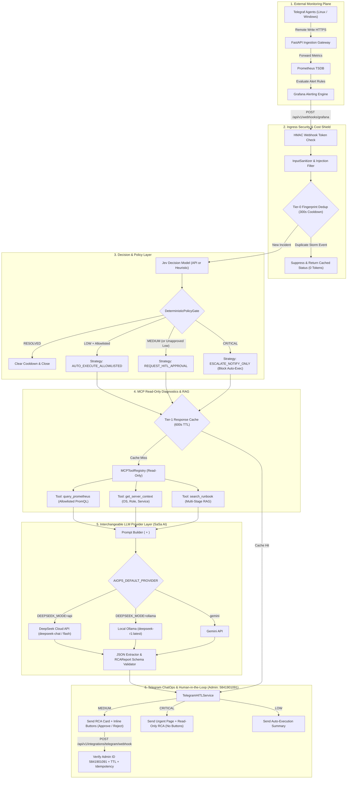
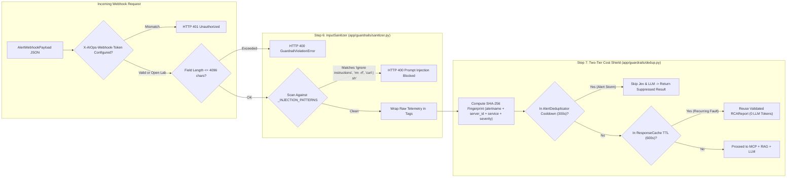
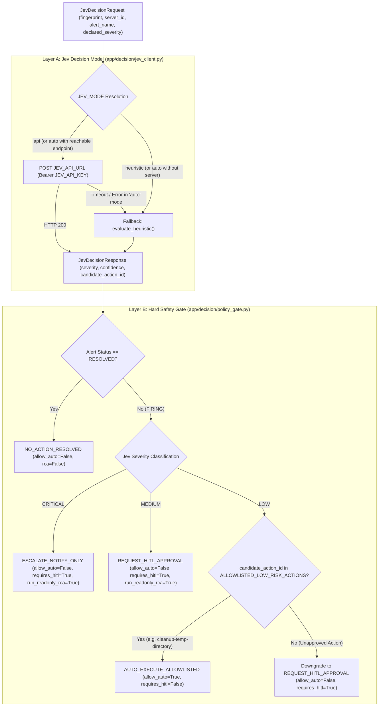
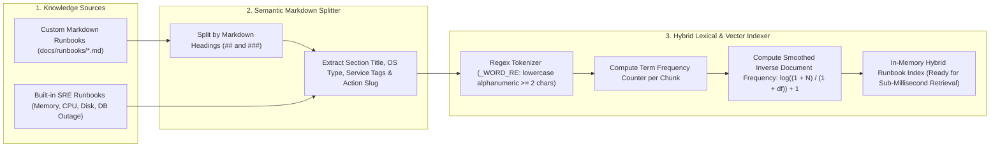
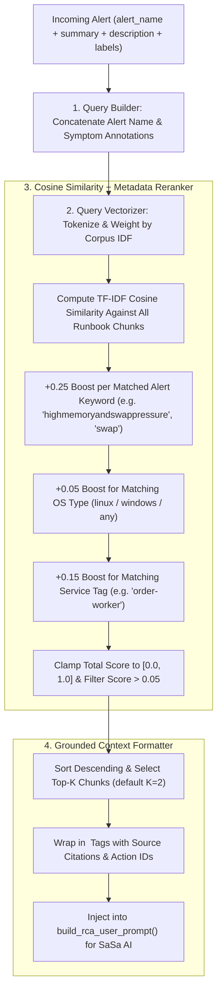
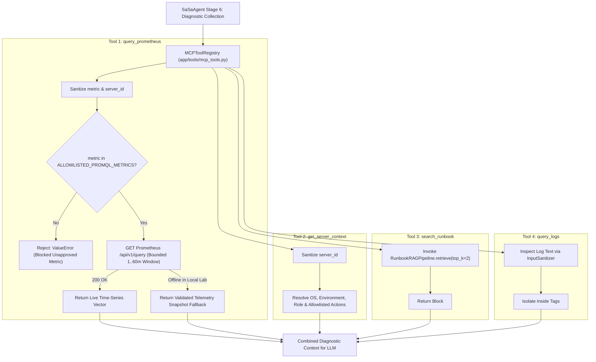
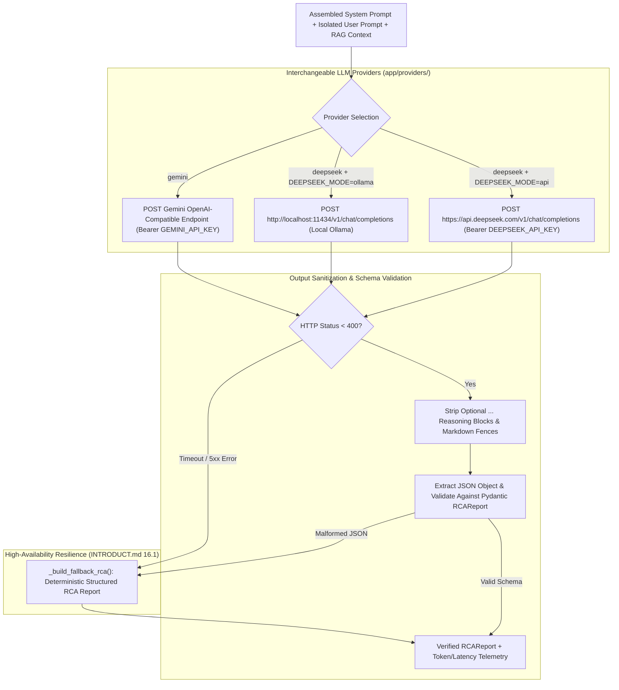
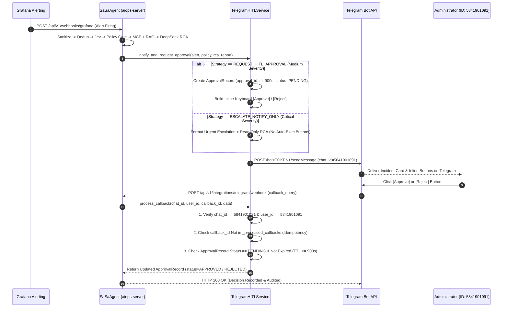
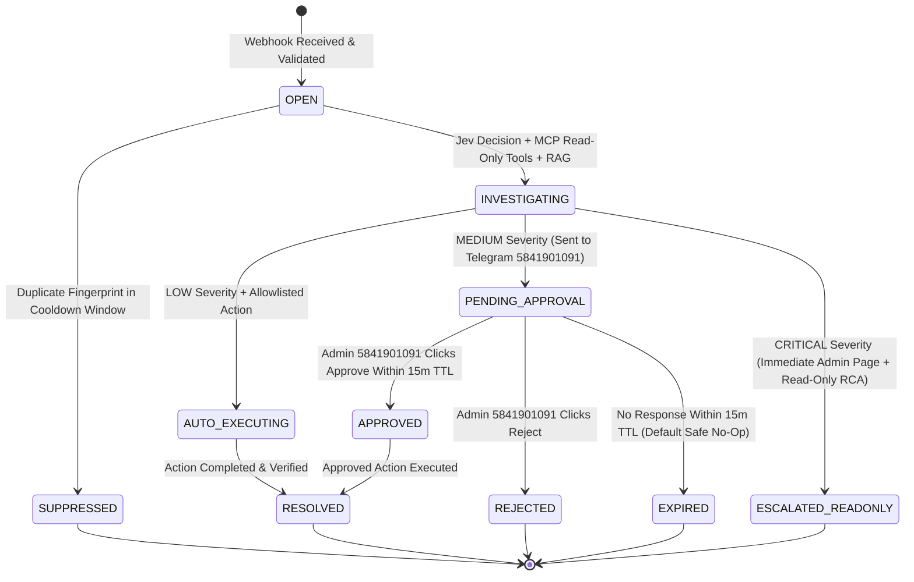
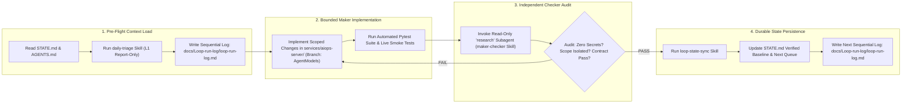

# InfraPulse AIOps (`SaSa AI`) — Detailed Multi-Pipeline Architecture Reference

> **Purpose**: Comprehensive visual blueprint of every pipeline, sub-pipeline, and micro-task inside `services/aiops-server/`, designed for executive presentations, architectural reviews, and engineering onboarding.

---

## Pipeline 1: Master End-to-End AIOps Execution Pipeline (Executive Overview)

This diagram illustrates the complete lifecycle of an infrastructure incident from Grafana alert generation to administrator approval on Telegram (`5841901091`).

---

## Pipeline 2: Ingress Security, Prompt-Injection Guardrails & Alert-Storm Cost Shield

Shows how `aiops-server` protects against malicious log/label payloads and prevents API budget exhaustion during cascading infrastructure failures.

---

## Pipeline 3: Dual-Layer Decision Engine (`Jev` Model + `DeterministicPolicyGate`)

Illustrates why the **Decision Layer** is decoupled from the **LLM Provider Layer** and how deterministic safety rules override model suggestions when necessary.

---

## Pipeline 4: Multi-Stage RAG — Stage A (Offline Runbook Ingestion, Chunking & Indexing)

Details how internal Markdown documentation (`docs/deployment/`, `docs/runbooks/`) is transformed into a searchable hybrid index inside `app/rag/runbook_rag.py`.

---

## Pipeline 5: Multi-Stage RAG — Stage B (Online Query, Metadata Reranking & Prompt Grounding)

Details how an incoming alert queries the RAG pipeline, applies domain-specific metadata boosts, and injects grounded context into the **SaSa AI** prompt.

---

## Pipeline 6: Model Context Protocol (MCP) Read-Only Diagnostic Tool Pipeline

Shows how `MCPToolRegistry` (`app/tools/mcp_tools.py`) executes strictly bounded, read-only diagnostic queries while preventing arbitrary metric or command access.

---

## Pipeline 7: Multi-Provider LLM Inference & Resilient RCA Fallback Pipeline

Details how **SaSa AI** communicates with **DeepSeek Cloud API**, **Local Ollama**, or **Gemini**, strips reasoning tags (`<think>`), validates the JSON output, and guarantees 100% uptime via deterministic fallback.

---

## Pipeline 8: Telegram ChatOps & Human-in-the-Loop (HITL) Sequence (`Admin ID: 5841901091`)

Sequence diagram showing the exact interaction between `SaSaAgent`, `TelegramHITLService`, the Telegram Bot API, and Administrator `5841901091`.

---

## Pipeline 9: Incident & HITL Approval Lifecycle State Machine

State diagram illustrating all legal state transitions for an incident inside `aiops-server`.

---

## Pipeline 10: Loop Engineering Development & Verification Governance Pipeline

Shows how our **Loop Engineering** system (`STATE.md`, `daily-triage`, `maker-checker`, and `loop-state-sync`) governs every code change on the `AgentModels` branch.

